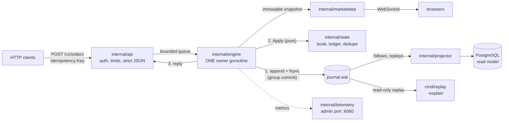

# Centralized Exchange

**A crash-safe spot-exchange matching engine in Go**: price-time matching,
an exact double-entry ledger, a checksummed write-ahead journal with group
commit, idempotent retries, and recovery by deterministic replay, measured
under load and proven by drills that kill the real server mid-traffic.

[](https://github.com/SrijitGyawali/Centralized-Exchange/actions/workflows/ci.yml)
[](go.mod)
[](docs/RELEASE.md)

> **Paper trading only.** Simulated funds; no real custody or money.

```bash
make demo   # a narrated three-minute tour against the real binary
```

## Highlights

| | |
|---|---|
| **Crash-safe** | 5 hard kills under 32-client load: **129,063 of 129,063** answered requests survived; **233 of 233** lost responses retried with exactly one effect ([drills](evidence/crash/2026-10-28/report.md)) |
| **Fast where it matters** | Group commit serves **3,200 orders/s at a 2.4 ms median**; one fsync per order saturates near 750/s ([performance](docs/PERFORMANCE.md)) |
| **Exact money** | Integer ticks, lots and atoms; every journal balances per asset; invariants checked at every start and after every drill kill |
| **Explainable** | `replay -explain <order>` recomputes any order from the journal: fills in priority order, reservations, every ledger posting |
| **Recoverable** | A million commands replay in **8 s**; a copy of a live journal restores to an exact prefix |
| **Observable** | Prometheus metrics with HTTP, engine, queue, fsync and apply latency kept apart; pprof on a private port; Grafana dashboards |
| **Honest** | Every claim links its evidence; what is not done or not tested is in [LIMITATIONS](docs/LIMITATIONS.md) |

## How it works



- **One writer.** A single goroutine owns the book, balances and dedupe
  table, so the state needs no locks and every command has one total order.
- **Durable, then applied, then answered.** A command is journaled and
  fsynced before it changes state; an answer therefore survives a crash.
  Queued commands share one fsync (group commit), with no batching timer.
- **Deterministic replay.** `Apply` is pure: no clock, no randomness, no
  I/O. Restart replays the journal into the same state, byte for byte, and
  the read model, the inspector and the drills all rely on it.

More: [architecture](docs/ARCHITECTURE.md) · [decision records](docs/adr/README.md)

## Quick start

Requires Go 1.26.10+ (selected automatically by `go.mod`). Docker Desktop is
needed only for the Compose stack and the PostgreSQL tests. The quick start
was checked on a [clean machine](evidence/quickstart/2026-10-28-clean-container.txt).

```bash
make run                       # the exchange on :8080, journal in ./data
curl localhost:8080/readyz     # ready, once the journal is recovered
# open http://localhost:8080/  # live book, trade tape and order form

go run ./cmd/replay -data-dir ./data              # replay a journal, read-only
go run ./cmd/replay -data-dir ./data -explain 4   # trace order 4 to its ledger postings
```

The full stack (exchange, PostgreSQL, Prometheus, Grafana):

```bash
make up            # :8080 exchange · :6060 metrics/pprof · :9090 Prometheus · :3000 Grafana
make load-step     # 100 → 3200 orders/s, with a CPU profile
make down
```

The Compose server is preloaded with local demo accounts
([deploy/cexd.env](deploy/cexd.env)); paste `loadgen-local-admin-0001` into
the web UI to fund and trade.

## Testing

```bash
make check                 # gofmt, vet, every test under the race detector
make test-integration      # PostgreSQL read model, with testcontainers (Docker)
go run ./tests/e2e         # HTTP API end to end against a crash-restarted server
make drills                # crash, retry, money, restore and recovery-time drills
make vuln                  # govulncheck
```

CI runs all of these on every push, plus the container build, its health
check, and a Prometheus config check.

| Guarantee | Proven by |
|---|---|
| A success response means durable **and** applied | `tests/crash` (failpoints at every write boundary), the drills |
| Restart reproduces the full state exactly | Digest equality with an independent replay, after every crash case and drill round |
| A retry with the same key never applies twice | `internal/state` tests, `tests/e2e`, the drills (233 lost responses) |
| Every asset's ledger sums to zero; no negative balance | Randomized tests after every command, startup checks, drill audits |

The failure model is **process crashes** on a persistent disk; power and
machine loss are not claimed ([limitations](docs/LIMITATIONS.md)).

## Repository layout

```
cmd/          cexd (server) · replay (inspector) · loadgen (load generator)
internal/     domain · command · book · state      the pure core: no I/O
              engine · journal · node              the single writer, durability, recovery
              api · marketdata · webui · projector the edges: HTTP, WebSocket, UI, SQL
              telemetry · clock · config           metrics, measuring, configuration
tests/        crash · e2e · drills · demo          black-box programs against the real binary
deploy/       Dockerfile, Compose, Prometheus, Grafana
loadtest/     versioned workloads and the outage drill
evidence/     raw benchmark, load, profile, drill and demo results
docs/         architecture, ADRs, performance, limitations, release notes
labs/         focused experiments (fsync latency)
track/        the build journal, one note per day
```

## Documentation

| | |
|---|---|
| [Architecture](docs/ARCHITECTURE.md) | Components, the life of an order, storage, the API |
| [Decision records](docs/adr/README.md) | Twelve ADRs: what was chosen, what was rejected, and why |
| [Performance](docs/PERFORMANCE.md) | Where the time goes under load, the bottleneck, the one optimization |
| [Limitations](docs/LIMITATIONS.md) | What is not done, not tested, and where it breaks first |
| [Release v0.1.0](docs/RELEASE.md) | Capabilities and the release gate, item by item with evidence |
| [Demo script](docs/DEMO.md) | The three-minute walkthrough and likely questions |
| [Build journal](track/README.md) | Built in eight weeks; the reasoning behind every step |

Configuration is by environment variables, all documented in
[.env.example](.env.example); the HTTP contract is in
[ADR-0007](docs/adr/0007-authenticated-http-api.md).
